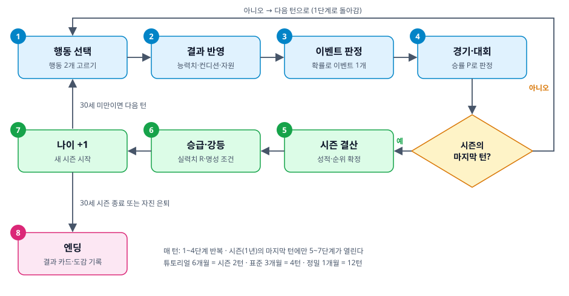
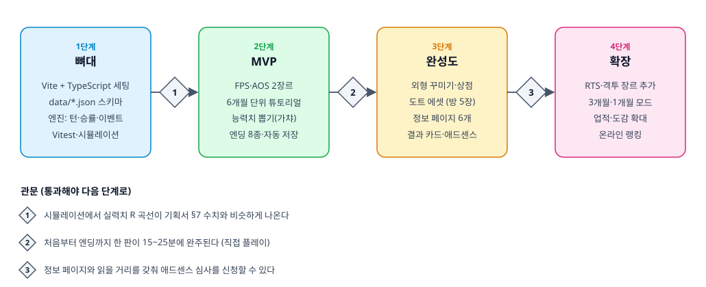

# 방구석 겜돌이에서 프로게이머되기 — 게임 기획서

## 1. 게임 개요

방구석 겜돌이에서 프로게이머되기는 16세 겜돌이가 시간을 어디에 쓸지 고르며 프로 계약, 우승, 은퇴까지 걸어가는 웹 육성 시뮬레이션이다. 설치와 로그인 없이 브라우저에서 한 판에 15~25분 안에 끝나는 것을 목표로 한다.

| 항목 | 내용 |
|---|---|
| 장르 | 육성 시뮬레이션 (텍스트 + 도트 그래픽) |
| 플랫폼 | 모바일·PC 웹 브라우저, 설치·로그인 없음 |
| 타깃 | 게임을 좋아하는 10~30대, 짧게 즐기는 육성·키우기 게임 팬 |
| 시작 조건 | 이름 입력, 나이 16세 고정, 주력 게임 장르 선택, 능력치 뽑기(가챠), 외형 꾸미기 |
| 1회 플레이 | 16세부터 최대 30세까지 한 커리어. 1회차는 6개월 단위 튜토리얼, 2회차부터 3개월 단위. 목표 15~25분 (플레이 테스트로 조정) |
| 핵심 재미 | 시간 배분 선택, 능력치 뽑기의 짜릿함, 눈에 보이는 성장, 꾸미기, 랜덤 이벤트, 엔딩 수집 |

이 문서의 수치(능력치 가중치, 확률, 승급 조건)는 모두 초안이며, MVP를 만든 뒤 직접 플레이하며 조정한다.

## 2. 레퍼런스 분석 (kickru.com)

킥루는 고교 벤치에서 시작해 프로, 주전, 국가대표를 거쳐 발롱도르를 노리는 도트 그래픽 축구 커리어 게임이고, 이 게임은 같은 성장 서사를 e스포츠로 옮긴다. 킥루 페이지에서 확인한 내용과 우리가 가져올 부분은 아래와 같다.

| 킥루에서 확인한 것 | 이 게임에 적용 |
|---|---|
| 고교 벤치에서 발롱도르까지 이어지는 성장 서사 | 16세 방구석에서 월드 챔피언십까지 |
| 시즌마다 기록이 쌓이고 선택이 커리어를 만든다는 소개 | 1시즌 = 1년, 턴 단위는 6개월·3개월 중 회차에 따라 선택, 시즌 말 결산 (§3) |
| 도트 스타일 그래픽 | 꾸밀 수 있는 도트 캐릭터와, 단계가 오를수록 바뀌는 방 배경 (§10) |
| 랭킹 메뉴 | 기기 내 기록부터 시작, 온라인 랭킹은 후속 (§11) |
| 서비스 소개, 게임 가이드, 개인정보처리방침, 이용약관, 문의, 사이트맵 메뉴 | 같은 정보 페이지 구성 (§13) |
| "개발자 서버비 내주기" 후원 버튼 | 후원 버튼 + 애드센스 (§13) |
| 구단·대회 명칭과 로고의 권리는 각 권리자에게 있다는 고지 | 실존 게임·팀 이름 대신 가상 이름을 쓰고 같은 고지문 추가 |

차별점은 세 가지다.

- 장르마다 능력치 가중치가 달라서 같은 훈련도 효율이 달라진다.
- 반응속도는 20대 중반부터 내려가고 판단력은 계속 오르는 나이 곡선을 게임 설정으로 둔다.
- 학교, 부모님, 알바 같은 방구석 생활 이벤트가 성장 과정에 끼어든다.

한계: 킥루는 접속 시 로딩 화면과 메뉴만 확인되어 능력치와 성장 공식 같은 세부 규칙은 알 수 없었다. 직접 플레이해 보고 가져오고 싶은 규칙이 있으면 알려 주세요.

## 3. 게임 루프



시즌이 시작될 때 플레이어가 **시즌 계획**(방침·훈련·레슨·장비·시설)을 세우면, 시즌 중 매 턴은 '다음 턴' 한 번으로 계획대로 자동 진행된다(행동 결과 반영 → 대회 진행·결과 공개 → 이벤트 판정 → 가끔 미니게임 순). 플레이어는 이벤트 선택, 코치의 훈련 교체 제안, 이적·콜업 제안, 연봉 협상 같은 큰 사건에만 직접 관여한다(§6). 시즌(1년)의 마지막 턴 뒤에만 시즌 결산이 열린다. 결산에서 승급·강등을 정하고 나이가 1살 오르며, 30세 시즌이 끝나거나 플레이어가 자진 은퇴하면 엔딩으로 넘어간다.

### 플레이 모드: 1회차는 튜토리얼, 2회차부터 선택

1회차는 6개월 단위로 크게 넘기며 능력치가 무엇을 하는지, 한 턴이 어떻게 흘러가는지 배우는 튜토리얼로 구성한다. 첫 엔딩을 보면 2회차부터 3개월 단위로 진행한다. (1개월 단위 정밀 모드는 2026-10-20에 없앴다.)

| 모드 | 턴 단위 | 시즌당 턴 | 최대 턴 수 | 특징 |
|---|---|---|---|---|
| 튜토리얼 (1회차) | 6개월 | 2 | 30 | FPS·AOS만 선택, 능력치·행동·컨디션을 짚어 주는 안내 팝업, 이벤트 확률이 높은 편 |
| 표준 (2회차~) | 3개월 | 4 | 60 | 장르 선택 (RTS·격투는 확장 단계에서 추가) |

행동 효과와 컨디션 변화는 3개월을 기준으로 정해 두고 턴 길이에 비례해 곱한다(6개월은 2배). 이벤트 확률도 턴 길이에 맞춰 "1 − 0.65^(턴 길이 ÷ 3개월)"로 계산해 6개월 약 58%, 3개월 35%가 된다. 그래서 모드를 바꿔도 30세까지의 성장 총량은 비슷하다(§7). 1회차 완료 여부와 해금 정보는 기기에 저장한다(localStorage).

## 4. 캐릭터 생성

생성은 이름 입력, 장르 선택, 능력치 뽑기, 외형 꾸미기의 네 단계이고, 뽑기를 여러 번 돌려도 2분 안에 끝나게 한다.

1. 이름 입력: 1~8자(한글·영문·숫자), 빈칸과 금칙어는 허용하지 않는다. 이름은 결과 카드와 기록에 표시된다.
2. 장르 선택: 1회차는 가장 대표적인 FPS와 AOS 중 하나를 고른다. RTS·격투는 확장 단계에서 추가되며 2회차부터 고를 수 있다. 나이는 16세로 고정되고, 고등학교 1학년 봄에서 시작한다.
3. 능력치 뽑기: 아래 "능력치 뽑기"처럼 6개 능력치와 시작 특성 1개를 무작위로 뽑는다. 시작 특성은 해당 능력치의 성장 계수를 1.2배로 만든다.
4. 외형 꾸미기: 기본 캐릭터에 옷·모자·장신구를 골라 입힌다.

| 장르 | 승부를 가르는 것 | 핵심 능력치 | 단계 |
|---|---|---|---|
| FPS | 총기 팀 대전, 순간 반응과 조준 | 정확도, 반응속도 | MVP |
| AOS | 5대5 팀 전략전, 판단과 팀 호흡 | 판단력, 팀워크 | MVP |
| RTS | 자원 관리와 병력 운영, 동시 처리 | 판단력, 집중력 | 확장 |
| 격투 | 1대1 대전, 입력 타이밍과 심리전 | 반응속도, 정확도 | 확장 |

장르는 일반 명칭만 쓰고 실존 게임 이름은 쓰지 않는다. 시작 특성은 능력치와 1대 1로 대응해 일단 6종으로 둔다.

- 손이 빠름: 반응속도 성장 1.2배
- 정밀 손목: 정확도 성장 1.2배
- 끈기: 집중력 성장 1.2배
- 눈썰미 좋음: 판단력 성장 1.2배
- 강철 멘탈: 멘탈 성장 1.2배
- 말발: 팀워크 성장 1.2배

시작 수치(초안): 능력치 6개는 뽑기로 정해지고(합계 600, 각각 최소 50), 컨디션 80, 돈 20만 원, 명성 0에서 시작한다.

### 능력치 뽑기 (가챠, 초안)

- 뽑기 버튼을 누를 때마다 6개 능력치 시작값과 시작 특성 1개가 한 세트로 나온다. 마음에 들 때까지 다시 돌릴 수 있고, 마지막으로 나온 세트로 시작한다.
- 능력치 최대치는 1000이다. 시작값은 6개 합계가 항상 600이다. 모든 능력치가 최소 50에서 시작하고, 남은 300을 6개 능력치에 무작위로 나눠 준다.
- 합계가 같으므로 선택한 장르에 맞게 몰렸는지로 등급을 정한다. 장르 가중치로 계산한 시작 실력치 R이 상위 1% UR, 4% SSR, 15% SR, 30% R, 나머지 50% N이고, R로는 약 122·115·107·99 이상이 각 등급의 경계다.
- 등급이 높을수록 연출을 크게 한다(빛, 효과음, 카드 뒤집기). 결과 화면에는 6각형 레이더 차트로 능력치를 보여 준다.
- 합계가 모두 같아서 등급이 높아도 성장 총량은 같고, 장르에 맞는 능력치가 높아 초반이 조금 빠를 뿐이다.
- 다시 뽑기는 무제한·무료다(뒤로 가기로 어차피 우회가 되므로 제한이 의미 없다). 다시 뽑은 횟수는 `rerolls`로 기록해 엔딩·게임 오버·결과 카드에 보여 준다.

### 외형 꾸미기

기본 도트 캐릭터 틀 하나에 옷, 모자, 장신구 레이어를 겹쳐 입힌다. 생성 단계에서 기본 아이템을 고를 수 있고, 이후 상점에서 돈으로 더 산다. 코스튬은 모습만 바꾸고 능력치에는 영향을 주지 않는다. 아이템 목록은 data/cosmetics.json으로 관리한다.

## 5. 능력치 시스템

능력치 6개가 장르별 가중치로 합쳐져 장르 실력치 R이 되고, R이 경기 승률을 정한다. 능력치는 0~1000이고, 높을수록 오르기 어렵다. 성장 속도는 일부러 느리게 잡았다(테스트 플레이 피드백: 2시즌 만에 능력치가 450·510이 되는 건 너무 빠르다). 숙련 플레이 기준 19~20세에 가장 높은 능력치가 450~550대, 28세에 가중 실력치 R이 830 안팎이다.

| 능력치 | 의미 | 주로 오르는 행동 |
|---|---|---|
| 반응속도 | 자극에 바로 반응하는 속도 | 기본기·반응 훈련 등 |
| 정확도 | 조준·컨트롤·입력의 정밀함 | 에임·정밀도 훈련, 랭크전 |
| 집중력 | 긴 경기에서 실수를 줄이는 힘 | 집중력 훈련, 연속 매치 |
| 판단력 | 상황 읽기와 운영 선택 | 영상 분석, 전략 공부 |
| 멘탈 | 큰 경기와 슬럼프에 버티는 힘 | 멘탈 단련, 휴식, 이벤트 선택 |
| 팀워크 | 소통과 역할 수행 | 팀 스크림, 콜 연습 |

### 장르별 가중치 (합계 100%, 초안)

| 장르 | 반응속도 | 정확도 | 집중력 | 판단력 | 멘탈 | 팀워크 |
|---|---|---|---|---|---|---|
| FPS | 25 | 30 | 15 | 10 | 10 | 10 |
| AOS | 15 | 15 | 15 | 20 | 15 | 20 |
| RTS | 15 | 15 | 25 | 30 | 10 | 5 |
| 격투 | 30 | 20 | 15 | 15 | 15 | 5 |

### 계산식

장르 실력치 R은 능력치 s에 가중치 w를 곱해 더한 값이다.

```latex
R = \sum_{i=1}^{6} w_i \, s_i
```

훈련 한 번의 능력치 상승폭 Δs는 아래와 같다. b는 행동의 기본 상승치, g는 성장 속도(`growthRate` 0.28), e는 장비 효율(1.0~1.2), c는 컨디션 단계 계수(0~30 부진 ×0.5, 31~60 평범 ×0.8, 61~80 좋음 ×1.0, 81~100 완벽 ×1.15), t는 시작 특성 계수(1.0 또는 1.2), k는 높을수록 덜 오르는 정도를 정하는 지수(`growthExponent` 0.30, 초반 속도는 유지하고 후반 능력치만 덜 오르게 2026-10-16에 0.15에서 올렸다)다. 이벤트·부작용이 능력치를 직접 바꿀 때도 g를 곱한다(곱하지 않으면 이벤트 하나가 훈련 여러 번 분이 된다). 튜토리얼(×1.03)과 정밀 모드(×0.93)는 시즌당 턴 수 차이를 보정하는 모드 계수를 더 곱하고, 정석 루트(아카데미 연습생)는 ×1.05다.

```latex
\Delta s = b \times g \times e \times c \times t \times \left(1 - \frac{s}{1000}\right)^{k}
```

예: 정확도 400, b=80, g=0.28, e=1.0, c=1.0, t=1.2이면 Δs = 80 × 0.28 × 1.2 × 0.6^0.3 ≈ 23.1이다. 내부에는 소수로 두고 화면에는 반올림해 보여 준다.

경기 승률은 내 실력치 R_me와 상대 실력치 R_opp의 차이로 정한다. 실력 차가 100이면 약 72%, 200이면 약 86%다. 상수 250은 밸런스 조정용 값이다.

```latex
P(\text{win}) = \frac{1}{1 + 10^{(R_{opp} - R_{me})/250}}
```

결승·승급전 같은 큰 경기에서는 멘탈 보정을 더해 R_me를 고친다. 멘탈 800이면 +30, 멘탈 100이면 -40이다.

```latex
R_{me}' = R_{me} + 0.1 \times (\text{mental} - 500)
```

### 나이 곡선 (게임 설정)

**에이징 커브(2026-10-19 강화)**: 25세부터 피지컬(반응속도·정확도·집중)은 시즌마다 `24 + 12 × (나이 − 25)`씩(한 해치를 매 턴 나눠 반영) 점점 더 크게 내려가고, 경험(판단력·멘탈·팀워크)은 시즌마다 +6씩 오른다(`rules.ageDecline`). 후반에는 피지컬이 떨어져도 경험으로 승부를 보는 구도이고, 29세 이상 시즌당 월드 우승률은 FPS 약 25~35%·AOS 약 50%(경험 장르)다. 또 **25세부터 훈련 효율이 해마다 6%씩 줄어**(최저 30%) 30세에는 64%가 되고, 판단력·멘탈·팀워크는 0.4배 속도로 느리게 줄어(30세에 86%) "젊음 vs 경험" 구도를 만든다(`rules.ageGrowth`, 2026-10-17 결정). 이 곡선 때문에 저연령에는 반응형 장르(FPS·격투)가, 고연령에는 판단형 장르(AOS·RTS)가 유리해진다.

## 6. 행동과 자원

한 턴마다 행동 2개가 일어나는데, **시즌 시작에 정한 계획이 컨디션에 맞춰 자동으로 고른다**(아래 "훈련과 시즌 계획"). 컨디션·돈·명성이 행동을 제약한다. 술자리·유흥·도박 같은 유혹은 행동 목록이 아니라 **이벤트 선택지**로만 나온다. 1시즌은 1년이고, 16세에서 최대 30세까지 15시즌이다(턴 수는 모드에 따라 30·60·180턴). 아래 표의 효과는 3개월 기준이며, 6개월 턴은 2배, 1개월 턴은 1/3배로 계산한다.

### 행동 (수치는 초안, 3개월 기준)

| 행동 | 효과 | 조건·비용 |
|---|---|---|
| 훈련 (시즌 훈련 하나) | 능력치 3개 (주 70, 부 50, 보조 40) | 컨디션 -8~-14. 아래 "훈련과 시즌 계획" 참고 |
| 휴식·운동 | 컨디션 +25, 멘탈 +20 | 없음 |
| 아르바이트 | 돈 +30만 원 | 컨디션 -10, 팀 소속 전에만 |
| 방송 | 명성 +5, 돈 +10만 원 | 컨디션 -10, 명성 20 이상 |
| 장비 구매 | 장비 효율 e 영구 상승 | 돈 소모. 턴과 행동 칸을 쓰지 않고, 시즌 시작 계획 때 돈이 되는 만큼 (횟수 제한 없음) |
| 개인 레슨 (특별 훈련) | 지금 장르 실력치를 가장 많이 올려 주는 능력치 3개 +70(장르 비중 × 현재 능력치·나이·특성을 반영한 상승량이 큰 순, `bestGainKeys`) | 돈 -40만 원, 컨디션 -5. 계획에서 켜면 컨디션 45 이상일 때 훈련 한 칸을 대신한다 |
| 친목 모임 | 컨디션 +22, 멘탈 +25, 팀워크 +20, 명성 +1 | 돈 -10만 원 |
| 술자리 | 컨디션 +35, 멘탈 +20 | 돈 -8만 원, 방탕 +1, 25%로 숙취(컨디션 -30, 명성 -2) |
| 유흥 | 컨디션 +20, 멘탈 +35 | 돈 -30만 원, 방탕 +1.5, 20%로 구설수(명성 -8, 돈 -10, 멘탈 -15) |
| 도박 | 30%로 돈 +55·멘탈 +10, 70%로 컨디션 -5·멘탈 -15 | 돈 -20만 원, 방탕 +1.5 (기댓값은 손해) |
| 기부·봉사 | 명성 +8, 멘탈 +10 | 돈 -60만 원, 컨디션 -3 |
| 재활 치료 | 컨디션 +10, 부상 회복 3개월 단축 | 돈 -5만 원, 부상 중에만 |
| 멘탈 상담 | 멘탈 +30, 슬럼프 회복 3개월 단축 | 돈 -10만 원, 슬럼프 중에만 |

장비는 키보드·마우스·모니터·PC 4종이고 각 **10단계**다. 단계를 올릴 때마다 가격이 **2배**가 된다(기본가 × 2^단계: 키보드·마우스 5만 원, 모니터 10만 원, PC 15만 원에서 시작해 마지막 단계는 키보드 2,560만 원). 한 종류를 끝까지 올리는 데 기본가의 1,023배가 들고, 40단계를 모두 채우면 e는 1.2다. 돈이 모자라면 돈이 드는 행동은 고를 수 없다.

#### 돈의 규모는 소속 단계에 따라 커진다

돈이 오가는 모든 것(훈련·친목·기부·술·유흥·도박, 이벤트의 돈, 대회 상금, 계약금)은 아래 표의 3개월 기준 기본 금액에 **소속 단계 배율**을 곱한다. 방구석에서는 용돈이던 금액이 프로가 되면 억 단위가 된다. 화면에는 "1억 2,500만"처럼 만·억 단위로 표시한다.

| 소속 단계 | 배율 | 예: 개인 레슨(기본 40) | 예: 기부·봉사(기본 60) | 월드 우승 상금(기본 500) |
|---|---|---|---|---|
| 방구석·지역 대회 | ×1 | 40만 | 60만 | - |
| 아마추어 팀 | ×2 | 80만 | 120만 | - |
| 프로 2부 | ×8 | 320만 | 480만 | - |
| 프로 1부 | ×30 | 1,200만 | 1,800만 | 1억 5천만 |

- 이벤트 선택지의 돈 조건(`minMoney`)과 이벤트 발생 조건(`money`)도 같은 배율로 맞춘다.
- 월급과 상금이 같이 커지므로, 돈이 남아도는 정도는 단계가 올라도 비슷하게 유지된다(자동 플레이에서 커리어 끝 자산이 20억 원대).

### 훈련과 시즌 계획: 큰 결정만 직접, 나머지는 자동으로

시즌 훈련 후보 4개는 시즌당 한 번 다시 뽑을 수 있고(`rerollTrainingMenu`), 제목 옆 `?`에서 나올 수 있는 훈련 전체를 볼 수 있다. 훈련 풀 21개는 능력치 3개 조합 20가지가 하나씩 있고(팀 전용 3개는 팀이 있어야 나온다) 나머지 하나는 장르 핵심 능력치 훈련이다.

테스트 플레이에서 "매 턴 훈련·휴식·돈벌기를 고르는 게 난잡하다"는 피드백이 나와(2026-10-16) 매 턴 선택을 없애고, **시즌 시작에 계획을 세우면 시즌 중에는 '다음 턴' 버튼만 눌러도 흘러가게** 바꿨다. 수치는 `data/plans.json`, 코드는 `engine/plan.ts`·`training.ts`, 화면은 `ui/planScreen.ts`다.

**훈련**: 모든 훈련은 능력치 3개를 올린다(주 70, 부 50, 보조 40). 6개 능력치에서 3개를 고르는 조합 20가지마다 훈련이 하나씩 있고(예: 에임 연습 = 정확도·반응속도·집중력), 장르 가중치 상위 3개를 올리는 랭크전 연습이 더해 풀은 21종이다. 팀 전용 훈련(팀 스크림·합숙·콜 연습)은 팀에 소속되었을 때만 후보에 든다. **시즌이 시작될 때 무작위 후보 4개가 뽑히고(시드·시즌으로 고정), 그중 하나를 이번 시즌 훈련으로 정한다.** 시즌 중에는 이 훈련만 할 수 있고 두 칸에 모두 들어갈 수 있다. 원하는 능력치만 계속 올릴 수 없게 하는 것이 목적이다.

**시즌 계획**: 시즌이 시작되면 계획 시트에서 ①방침(프리셋) ②이번 시즌 훈련 ③개인 레슨 여부 ④장비·시설 구매를 정한다.

| 방침 | 컨디션 구간별 행동 |
|---|---|
| 훈련 집중 | 50 이상 훈련 2번, 30 이상 훈련+휴식, 그 아래는 휴식 |
| 균형 (기본) | 60 이상 훈련 2번, 40 이상 훈련+휴식, 아래는 휴식 |
| 컨디션 관리 | 80 이상일 때만 훈련 2번, 60 이상 훈련+휴식 (가장 효율이 좋다) |
| 돈벌이 병행 | 70 이상 훈련+아르바이트·방송, 45 이상 훈련+휴식 |

부상 중이면 쉬며 재활하고, 슬럼프면 쉬는 칸을 상담으로 바꾼다. 못 하는 행동(돈 부족 등)은 휴식이 된다.

**코치의 교체 제안**: 리그가 시작될 때 팀 전력과 내 실력으로 **기대 순위**를 정해 두고, 중간 순위가 기대보다 리그 크기의 25%(최소 2) 이상 낮으면 시즌당 한 번 팀 소속 선수에게 후보 3개로 훈련 교체를 제안한다(`rules.coachSwap`). 후보는 무작위가 아니라 **부족한 능력치를 채워 주는 순서**다(2026-10-18, `training.ts` `fillScore`: 능력치별 (최고 능력치와의 차이 × 장르 비중) × 훈련 상승량의 합, 동점은 시드 순서). 거절해도 그 시즌의 제안은 끝나고, 팀이 없으면 코치도 없다.

- 아직 없는 것: 대회 참가 여부를 플레이어가 정하는 흐름 (지금 대회는 자동 참가).

### 시설 투자: 후반 돈 소비처
(구매 전에는 확인 팝업이 뜨고, 장비·시설마다 단계별 도트 그림이 업그레이드 연출과 함께 바뀐다 — `upgradeArt.ts`, 2026-10-16.)

장비를 다 올리고 나면 돈 쓸 곳이 없다는 피드백(2026-10-16)으로 추가했다(`data/facilities.json`, `engine/facilities.ts`). 시즌 계획 화면에서 산다.

| 시설 | 효과 | 최고 단계 |
|---|---|---|
| 숙소 | 턴당 컨디션 회복 +1/레벨 | 5 |
| 개인 코치 | 훈련 효율 +1.5%/레벨 | 5 |
| 재활 트레이너 | 부상·슬럼프 회복 속도 +25%/레벨 | 3 |
| 홍보 에이전시 | 턴당 명성 +0.3/레벨 | 5 |

가격은 `기본가 × 소속 단계의 돈 규모 × 2.5^단계`라서 프로가 되어 수입이 커져도 계속 비싸다. 가족 선물·집·구단 투자 같은 더 큰 소비처는 계약 시스템과 묶어 이후 설계한다.

### 턴 끝 미니게임

계획대로 자동 진행되는 것이 지루하지 않도록, 시즌이 이어지는 턴이 끝날 때 **약 30% 확률로** 쉬는 시간 미니게임이 뜬다(`data/minigame.json`의 `chance`, 같은 판·같은 턴이면 같은 결과). 종류는 사격(에임 워밍업)·짝 맞추기·반응속도 테스트·숫자 순서 터치·패턴 기억 5종 중 무작위다. 잘하면 **다음 턴 훈련 효율이 +4%(좋음) 또는 +8%(최고)** 오르고, 건너뛰거나 못 해도 손해는 없다(그 턴이 지나면 보너스는 사라진다). 끝나면 명중 수·평균 반응속도·걸린 시간 같은 기록을 보여 준다. 엔진은 점수 → 등급만 알고(`engine/minigame.ts`) 게임 자체는 UI(`ui/miniGame.ts`)에 있다. 기준 점수와 보너스 크기는 직접 플레이로 조정할 초안이다.

### 능력치 설명

능력치 이름 옆의 `?` 아이콘에 마우스를 올리거나(모바일은 눌러서) 보면 그 능력치가 무엇이고 어디에 도움이 되는지(경기·큰 경기 보정·슬럼프·입단 시험 등), 지금 장르에서의 비중, 주로 오르는 훈련, 나이에 따른 변화(반응속도·정확도는 25세부터 하락)가 나온다. 훈련을 고를 때 판단 근거가 된다. 홈 화면·뽑기·시즌 결산 화면에 같이 쓴다.

### 컨디션 단계

컨디션이 0이어도 훈련은 할 수 있지만 성과가 크게 떨어지고, 낮은 것의 위험을 플레이어가 알 수 있게 홈 화면 컨디션 옆에 도움말 아이콘(?)을 둔다. 마우스를 올리거나(모바일은 눌러서) 단계별 효과와 위험, 턴마다의 자연 회복량을 보여 주고 현재 단계를 강조한다.

| 컨디션 | 단계 | 훈련 성과 |
|---|---|---|
| 81~100 | 완벽 | ×1.15 |
| 61~80 | 좋음 | ×1.0 |
| 31~60 | 평범 | ×0.8 |
| 0~30 | 부진 | ×0.5 |

- 턴마다 컨디션이 저절로 8(3개월 기준, 턴 길이에 비례) 회복된다. 휴식·친목 모임 같은 회복 행동은 그 위에 더해진다.
- 29 이하면 슬럼프 이벤트(성장이 절반), 34 이하면 부상 이벤트 위험이 있다.
- 두 번째 행동은 첫 행동으로 줄어든 컨디션 기준으로 계산한다. 그래서 훈련을 연달아 하면 두 번째가 덜 오르고, 컨디션 관리가 곧 성장 관리다.

### 스트레스 해소와 방탕 게이지

스트레스 해소(친목·술·유흥·도박)와 기부는 돈을 쓰는 행동이라 돈이 남아도는 문제를 줄이고, "지금 무엇을 고르느냐"가 실력을 가르게 만든다.

- 친목 모임은 안전한 대신 효과가 적당하고, 술자리·유흥·도박은 더 크게 회복하거나 한 방이 있지만 부작용 확률이 있다.
- 술·유흥·도박을 하면 **방탕 게이지**가 오른다. 게이지가 높을수록 숙취·구설수 확률이 올라가고(게이지 1당 +8%p), 4 이상이면 매 턴 컨디션 -8, 멘탈 -15의 중독 패널티가 붙는다. 이런 행동을 하지 않으면 3개월마다 0.5씩 내려간다.
- 게이지가 3 이상이면 "중독 경고" 이벤트가 나온다. 멘탈이 높으면 스스로 끊을 수 있고, 돈을 내고 전문가의 도움을 받을 수도 있다.
- 명성은 기부로도 올릴 수 있다(돈 60만 원 → 명성 +8). 자선 행사 이벤트에서는 더 크게 후원할 수도 있다.
- **위험 행동(술자리·유흥·도박)과 관련 이벤트(술자리 제안·도박 제안·중독 경고)는 2회차부터** 나온다. 1회차 튜토리얼에서는 막혀 있고, 친목 모임과 기부는 튜토리얼에서도 할 수 있다.

### 부상·슬럼프 대처

돌발 상황에 어떻게 대처하느냐가 실력에 영향을 준다.

- 부상 중에는 휴식과 재활 치료만 할 수 있다. 병원 치료는 돈이 들지만 실력 손실이 없고, 참고 계속하면 부상이 6개월로 길어지면서 반응속도·정확도가 영구히 30씩 깎인다. 집에서 재활 운동을 하면 멘탈 판정에 따라 3개월 또는 5개월(능력치 손실 있음)이 걸린다.
- 슬럼프는 성장이 절반이 되는 상태이고, **멘탈이 높을수록 기간이 짧아진다**(멘탈 500이면 1배, 1000이면 0.6배, 0이면 1.4배). 이를 악물고 버티는 선택은 멘탈 판정(성공 확률 = 멘탈÷1000)이라 멘탈이 높을수록 성공해서 빨리 끝나고, 낮으면 실패해 오래간다.
- 팀원·선배에게 털어놓기는 팀에 소속되어야, 전문가 상담은 돈이 있어야 고를 수 있다. 평소 팀워크와 돈을 쌓아 두면 위기에 쓸 수단이 늘어난다.

### 자원

| 자원 | 범위 | 역할 | 낮을 때 |
|---|---|---|---|
| 컨디션 | 0~100 | 성장 효율 c를 정한다 | 30 미만이면 슬럼프·부상 이벤트 위험 |
| 돈 | 만 원 | 장비·시설 구매, 팀 생활비 | 0이면 장비를 살 수 없다 |
| 명성 | 0 이상 | 스카우트 제안과 스폰서 조건이 된다 | 낮으면 팀 입단 제안이 오지 않는다 |

학교와 부모님은 규칙을 늘리지 않는 가벼운 장치로만 둔다. 고등학교 시기(16~18세)에는 학교 피로로 3개월마다 컨디션이 10 깎이고(턴 길이에 비례), 부모님이 3개월마다 용돈 5만 원을 주며 멘탈이 낮으면 멘탈 케어 이벤트가 나온다. 18세 시즌이 끝나면 모두 사라진다. 수치는 초안이다.

## 7. 커리어 진행

커리어는 7단계이고, 프로 2부에서 1부로는 시즌 결산 때 실력치 조건을 채우면 1부 팀의 **콜업 제안**을 받아 올라간다(아래 "콜업과 연봉 협상"). 방구석~아마추어 팀 구간(초반 16~21세)은 **성적과 시험으로 루트가 갈린다**(아래 "초반 루트"). 성장 속도를 늦춘 뒤 숙련 플레이의 가중 실력치 R은 대략 17세 200, 19세 330, 20세 390, 22세 500, 24세 650, 26세 750, 28세 830에 닿는다. 사다리는 실제 프로게이머 시장(데뷔 17~21세, 은퇴 25~28세)에 맞춰 압축했다: 숙련 플레이는 16.5세에 아카데미 초대, 18.5세 아마추어 팀, 19.6세 프로 2부, 21세 프로 1부(상세 근거는 `docs/career-pacing-plan.md`). 모두 초안이며 플레이 테스트로 다시 맞춘다.

| 단계 | 승급 조건 (초안) | 무대와 보상 |
|---|---|---|
| 1. 방구석 랭커 | 시작 | PC방 대회(최대 3번 도전)와 랭크전 |
| 2. 지역 아마추어 대회 | PC방 대회를 3번 도전했거나(2번 + R 180 이상이면 2번), 아카데미 입단에 끝내 실패 | 지역 토너먼트, 상금과 명성 |
| 3. 아마추어 팀 입단 | 정석: 아카데미 입단 테스트 합격. 우회: 지역 대회 4강 이상 + R 230 이상(스카우트 3팀) 또는 공개 입단 테스트 합격 | 팀 훈련 해금, 생활비 지원 |
| 4. 프로 2부 리그 | 정석: 프로 트라이아웃 합격. 우회: 프로 2부 공개 테스트 합격 (스카우트 3팀 중 선택) | 프로 계약, 월급 |
| 5. 프로 1부 리그 | R 250 이상이면 1부 팀의 콜업 제안(거절하면 2부 잔류) | 정규 시즌과 플레이오프, 스폰서 |
| 6. 월드 챔피언십 | 1부 시즌 상위 4팀 안 | 국제 토너먼트, 최고 명성 |
| 7. 레전드 | 월드 챔피언십 우승 | 명예의 전당 엔딩 |

### 초반 루트 (16~21세): 성적과 시험으로 갈린다

예전에는 시즌 결산 때 R이 조건을 넘으면 자동으로 승급해서 16~21세 내내 훈련만 반복했다. 지금은 나이마다 기회의 문이 열리고, 어느 문으로 들어가느냐는 성적과 선택이 정한다. 상세 설계와 근거는 `docs/early-career-plan.md`, 수치는 `data/routes.json`·`data/tests.json`이다.

```
방구석 랭커 ─ PC방 대회(시즌마다, 최대 3번)
   ├ 4강 이상 ─► 아카데미 입단 테스트 초대 ─► 합격: 아카데미 연습생(정석) ─► 프로 트라이아웃 ─► 프로 2부
   │                                         └ 불합격: 1년 뒤 한 번 재도전, 또 떨어지면 지역 대회로
   └ 부진 ─► 재도전 ─► 지역 아마추어 대회(22세까지)
                         ├ 4강 이상 + R 230 ─► 스카우트 3팀 중 선택 ─┐
                         └ 8강 이상 ─► 공개 입단 테스트 ─► 합격 ───────┴► 아마추어 팀(우회) ─► 프로 2부 공개 테스트 ─► 프로 2부
```

- **시험**: 항목별 달성도(내 값 ÷ 목표)의 가중합 + 준비 보너스 + 운(표준편차 0.08)이 1.0 이상이면 합격한다. 실기(장르 실력치)가 가장 비중이 크고 면접(멘탈)·팀플(팀워크), 프로 2부 공개 테스트는 인지도(명성)도 본다. 같은 실력이면 정석 쪽 시험(트라이아웃)이 공개 테스트보다 쉽다.
- **시험 준비**: 시험이 있는 시즌이 끝나면 준비를 하나 고른다. 집중 준비(보너스 +0.10, 컨디션 -15), 컨디션 관리(+0.04, 컨디션 +15), 선배에게 조언(60%로 +0.16, 돈 -10).
- **정석**의 이점은 아카데미 연습생이 리그 성적이 나빠도 방출되지 않고 성장이 5% 빠른 것, 부담은 평가에서 한 해를 잃을 수 있고 팀을 고를 수 없다는 것이다. **우회**는 느리지만(아마추어 진입 21~22세, 정석은 19세) 스카우트에서 팀과 조건을 고를 수 있다.
- 자동 플레이 측정(숙련, FPS 표준)에서 정석 57%, 우회 43%였고, 무작위 플레이는 60%가 끝내 아마추어 팀에 들어가지 못했다.
- 불합격해도 게임 오버는 아니다. 재도전하거나 지역 대회로 우회하고, 나이 한계(지역 대회 22세)를 넘으면 취미·스트리머 쪽 엔딩으로 기운다.

### 시즌 일정과 결과 공개

대회는 시즌 안의 정해진 기간(시즌의 몇 %~몇 %)에 열린다(`competitions.json`의 `span`). 예: 프로 1부 AOS는 전반기 리그(0~30%) → 선발전 → 국제전 → 후반기 리그(50~78%) → 플레이오프 → 월드(86~100%). 프로 2부와 아마추어 리그는 시즌 내내 도는 한 리그다. 모드의 턴 수와 상관없이 같은 달력이다.

- 기간이 시작될 때의 능력치로 결과가 정해지고(대회마다 시드 난수), **리그는 기간의 절반에 중간 순위, 끝에 최종 순위와 보상**을 알려 준다. 토너먼트는 끝날 때 순위와 1~3위 팀을 알려 준다. 진출권이 없으면 그 대회는 열리지 않는다.
- 턴을 누르면 "○○ 중…" 하며 시간이 흐르는 연출이 나오고, 대회가 끝나는 시점마다 결과 카드가 뜬다. 확인하면 이어서 진행한다. 홈 화면에는 이번 시즌 일정(예정·진행 중·중간/최종 순위)이 보인다.
- 시즌 결산은 이미 본 결과를 요약하고 승급·강등·엔딩을 정한다.

### 시즌 결산과 대회 구조

시즌 결산 때 그 단계의 대회를 한꺼번에 치르고 승급·강등을 정한다(모드와 관계없이 같다). 대회 이름과 팀은 모두 가상이고, 구조만 실제 e스포츠(AOS는 지역 리그·미드시즌 국제전·월드, FPS는 지역 리그·마스터즈·챔피언스)를 참고했다. 상대 팀 실력치는 단계별 평균과 표준편차에서 뽑는다(25세 이후 훈련 효율 감소를 넣은 뒤 튜토리얼 성장 1.06·정밀 0.98로 보정했고 튜토리얼은 월드 챔피언십에서만 전력 +30을 더한다. 300판 측정 숙련 우승: 튜토리얼 FPS 4%·AOS 9%, 표준·정밀 3~8%) (`competitions.json`, 초안). 모든 경기는 승률 P로 판정하고, 3판 2선승제·5판 3선승제는 한 판 승률에서 시리즈 승률을 계산한다. 결승·플레이오프 같은 큰 경기에는 멘탈 보정을 더한다.

| 단계 | 대회 |
|---|---|
| 방구석 랭커 | PC방 대회: 8팀 단판 토너먼트 (모든 모드). 아카데미 초대를 받은 해에는 나가지 않는다 |
| 지역 아마추어 대회 | 16팀 단판 토너먼트 |
| 아마추어 팀 | 6팀 더블 라운드로빈 (경기 10회) |
| 프로 2부 | 6팀 더블 라운드로빈, 3판 2선승제 |
| 프로 1부 (AOS형) | 전반기 리그(10팀) → 상위 6팀 미드시즌 선발전 → 우승팀이 미드시즌 국제전(12팀) → 후반기 리그 → 상위 6팀 플레이오프, 상위 3팀이 월드 진출 → 월드 챔피언십(16팀). 국제전 우승팀은 월드 직행 |
| 프로 1부 (FPS형) | 킥오프(12팀, 3패 탈락)로 상위 3팀이 마스터즈 1 → 스테이지 1(12팀) → 상위 8팀 플레이오프, 상위 3팀이 마스터즈 2 → 스테이지 2 → 상위 8팀 플레이오프, 상위 2팀이 챔피언스 직행, 챔피언십 포인트가 14 이상이면 추가 진출 → 챔피언스(16팀) |

- 토너먼트는 "k패 탈락" 하나로 처리한다(단판 k=1, 더블 엘리미네이션 k=2, 킥오프 k=3). 실제 대진표와 정확히 같지는 않다.
- 챔피언십 포인트는 플레이어의 대회 성적만 합산하고, 진출 기준은 AI 팀 포인트 비교 없이 고정 문턱(14)을 쓴다.
- 월드 챔피언십은 별도 단계가 아니라 1부 시즌의 마지막 대회다. 월드에 나가면 `월드 진출`로 기록되고, 우승해도 커리어는 이어진다(2026-10-17 변경: 한 번 우승했다고 바로 은퇴하는 프로는 없다). 30세 시즌이 끝나거나 자진 은퇴할 때 누적 우승 횟수 등으로 엔딩이 정해진다(§9).
- 승급은 한 시즌에 한 단계까지다. 스카우트로 아마추어 팀과 프로 2부에 들어갈 때는 제안 3팀(공개 테스트 합격은 2팀) 중 하나를 골라야 하고, 팀마다 연봉(돈 +40) 또는 출전 기회(명성 +8) 중 하나를 준다.
- **팀에는 성격이 있다.** 팀마다 시드로 정해지는 전력(시즌마다 조금 변동, 리그에서 맞붙을 때의 전력과 같은 값)·지난 시즌 순위·월급이 있고, 입단·이적 제안 화면이 그대로 보여 준다(팀 아이콘, 전력과 내 실력과의 차이, 지난 시즌 순위, 월급과 지금 월급과의 차이, 계약금 또는 출전 기회, 대회 전력 보정). 입단·이적이 확정되면 서명 → 팀 도장 → 악수 도트 연출이 나온다.
- **월급**: 팀에 소속되어 있으면 턴마다 들어온다(3개월 기준 아마추어 팀 120만·프로 2부 800만·프로 1부 3,000만 원에 팀 강도 0.8~1.4배, 명성이 높을수록 최대 2.5배까지 오른다. 정석 루트 연습생은 60만 원, 턴 길이에 비례). 프로 1부 평균 팀이면 연 1억 2천만 원, 명성이 높은 스타는 연 3억 원 이상으로 실제 프로 연봉 규모에 맞췄다.
- **팀 강도**: 소속 팀 전력이 리그 평균보다 높으면 대회 전력에 +, 낮으면 −가 붙는다(차이의 0.3배). 평균 팀이면 0이라 전체 난이도는 그대로고, 어느 팀을 고르느냐가 성적과 월급에 영향을 준다.
- 팀에 소속된 선수는 명성이 30 이상이면 **시즌 중간에도** 다른 팀의 이적 제안(2팀)을 받을 수 있다. 시즌당 한 번, 마지막 턴 뒤에는 오지 않고 거절할 수 있다. 정석 루트의 연습생은 받지 않는다.
- **이적 요청**(2026-10-17): 플레이어가 직접 시즌 중간(첫 턴 뒤~마지막 턴 전)과 시즌 결산 때 각각 시즌당 한 번 요청할 수 있다. 팀 소속·명성 30 이상·연습생 제외. 요청이 늘 받아들여지지는 않고 성공 확률은 35% + 명성×0.4%p(20~90%)다. 성공하면 다른 팀 최대 3곳의 제안이 오며 거절할 수 있고, 관심 있는 팀이 없으면 그 요청 기회만 쓴다.
- 프로 1부에서 명성 50 이상이면 시즌마다 35% 확률로 이적 제안 2팀이 온다. 거절하고 남을 수 있다.
- 시즌 순위가 하위 20%(최소 1팀)면 한 단계 강등된다. 프로 1부는 2부로, 프로 2부는 아마추어 팀(다른 팀)으로, 아마추어 팀은 방출되어 지역 대회 단계로 돌아간다. 나이 곡선으로 R이 떨어지는 시기에는 코치나 스트리머 엔딩으로 갈 수 있다(§9).
- 시즌마다 같은 라이벌과 한 번 맞붙고, 이기면 명성이 3 오른다.
- 자진 은퇴는 시즌 결산을 마친 뒤 언제든 고를 수 있다. 단 튜토리얼은 월드 우승 전까지 중간 은퇴가 막혀 있다. 우승 뒤에는 열린다.

#### 콜업과 연봉 협상

- **콜업(프로 2부 → 1부)**: 조건(R 250 이상)을 채우면 자동 승급 대신 **1부 팀 3곳의 콜업 제안**이 오고 알림이 뜬다. 첫째는 지금 팀의 1군 콜업이고 나머지는 다른 구단이다. 고르면 1부로 올라가고 그 팀이 1부 데뷔 팀(원클럽 히든 기준)이 된다. 거절하면 2부에 남고, 조건은 매 시즌 다시 본다. 제안 카드에는 1부 기준의 팀 전력·지난 시즌 순위·월급이 보인다. 제안 팀이 약팀일 수도 있어 선택에 의미가 있다.
- **연봉 협상**(`engine/negotiation.ts`, `data/contracts.json`): 팀에 소속된 선수(연습생 제외)는 계약 직후(입단·이적·콜업)와 시즌 결산 때 **시즌당 한 번** 월급 인상을 요구할 수 있다. '조금 더 요구'(+15%, 기본 성공 70%)와 '크게 요구'(+35%, 기본 40%, 실패하면 멘탈이 떨어진다) 중 고르고, 명성 1당 성공 확률이 0.2%p 오른다(최대 +25%p, 5~95%). 성공하면 월급 배율이 오르고, 팀을 옮기거나 강등되면 초기화된다. 계약 기간·재계약·팀의 역제안은 아직 없다.

#### 시즌 활약

시즌 결산에 그 시즌의 활약을 정리한다(`engine/highlights.ts`, `data/highlights.json`). 마지막 공식 리그의 순위표로 **시즌 평점**(팀 승률 + 내 실력의 리그 대비 위치 + 잡음)과 리그 선수 평점 순위·리그 내 수준(최상위/상위/중위/하위)을 만들고, 수상 기록(리그 MVP·시즌 베스트 멤버·올해의 신인·리그 우승 팀·승률왕·대회 우승·월드 결승 MVP)을 준다. 결산 화면의 '시즌 활약' 카드와 엔딩 화면의 시즌별 기록에 보인다. 경기별 개인 기록(킬·어시스트 등)은 아직 없다.

#### 비공식 초청 대회

프로 1부 일정 마지막에 **슈퍼 인비테이셔널**이 있다. 짝수 시즌(2년에 한 번)에만 열리고, 팀 소속 + 명성 80 이상 + 직전 시즌에 후반기 리그 4위 이내이거나 월드에 나갔을 때 초청된다(조건은 플레이어에게 알려 주지 않고 '초청 받음/초청 미정'만 보인다). 16팀 국제 상대, 우승 상금이 공식 대회보다 크고 명성은 월드보다 낮으며, 골든로드 같은 "시즌 모든 공식 대회" 기록에서는 빠진다.


#### 난이도 방침

월드 진출과 우승은 쉬우면 성취감이 없지만, 전성기 선수가 국제전에서 꼴찌를 하면 현실과 안 맞는다(2026-10-19). 그래서 **숙련 플레이는 20대 중반에 월드를 제패할 수 있게** 두었다. 상대 팀 실력치(평균/편차)는 단계별로 PC방 대회 165/35, 지역 대회 210/40, 아마추어 리그 230/40, 프로 2부 320/45, 국제전 770/35이고, 프로 1부는 구단 12곳을 시드마다 강호 5팀(평균 760)·중위권 4팀(620)·약팀 3팀(340)으로 나눈다(`competitions.json`, 초안). 신인은 약팀에서 시작해 크면서 강팀으로 옮긴다. 자동 플레이 봇(`src/sim`)으로 측정한 결과는 아래와 같고, 회귀 테스트(`src/sim/balance.test.ts`)가 이 범위를 지킨다.

| 플레이 | 1부 시즌당 월드 진출 | 한 판에 월드 진출 | 한 판에 월드 우승 |
|---|---|---|---|
| 단순(기본 방침 '균형'+앞의 훈련, 장비 안 삼) | 0~1% | 1~10% | 0% |
| 숙련(방침·훈련·레슨·장비를 시즌 단위로 골라 봄) | 9~19% | 46~68% | 2~14% |

- 시즌 계획으로 자동 진행이 되면서 아무렇게나 눌러도 컨디션이 무너지지 않아, 단순·무작위 플레이도 예전보다 실력이 오른다(최종 R 숙련 약 870~900, 단순 약 660~720, 무작위 약 750~790). 회귀 테스트 기준은 "숙련−단순 120 이상, 숙련−무작위 80 이상, 정밀 모드의 숙련−단순 격차가 표준보다 큼"으로 다시 썼다. 100판 표본의 잡음이 ±3~4%p라 수치를 바꾸면 150판으로 확인한다.
- 1부 플레이오프 진출은 구조상 평균 팀도 60% 안팎으로 들어가므로, 어려운 구간은 "플레이오프 상위권 → 월드 진출"이다.
- 튜토리얼 모드에서는 히든 엔딩이 열리지 않는다. 데뷔 팀에서 우승해도 레전드 엔딩이 된다.

## 8. 이벤트와 랜덤 요소

이벤트는 JSON 한 항목만 추가해 늘릴 수 있게 만들고, 턴마다 확률(3개월 기준 35%, 초안)로 하나가 발생하고, 턴이 길수록 확률이 올라간다(§3). 단계 전환과 시즌 말에는 조건을 충족하면 고정 이벤트가 나온다.

- 부모님·학교(고등학교 3년만): 용돈 지원, 멘탈 케어 대화, 시험 기간 피로
- 슬럼프: 컨디션이 30 미만일 때, 다음 6개월 동안 성장이 절반으로 줄어든다
- 부상: 컨디션 관리 없이 연습만 반복하면 3~6개월 쉬어야 한다
- 라이벌: 시즌마다 같은 라이벌과 맞대결하고, 이기면 명성이 오른다
- 스카우트 제안: 조건을 충족하면 팀 2~3곳이 제안하고, 연봉과 출전 기회 중 선택한다
- 행운·불운: 장비 고장, 정전, 영상이 우연히 퍼짐
- 팀 내 갈등: 팀워크가 낮을 때 팀 소속 시기에 발생
- 초반 루트: PC방 고수의 도전장·사장님의 후원 제안·탈락 후 격려·초대장을 받은 날(방구석), 지역 대회 스카우트 소문·가족의 걱정·스트리머 콜라보(우회), 선배 연습생과의 스파링·월말 평가·합숙소의 밤(정석)

이벤트 데이터 예시(`events.json`의 한 항목)다. 조건과 효과만 바꿔도 새 이벤트가 된다.

```json
{
  "id": "parents_mental_care",
  "when": { "stages": ["basement", "local_cup"], "ageMax": 18, "stat": { "mental": { "max": 300 } } },
  "weight": 3,
  "text": "성적이 떨어져 풀이 죽은 나를 보고 부모님이 조용히 야식을 사 오셨다.",
  "choices": [
    {
      "label": "속마음을 털어놓는다",
      "effects": { "stats": { "mental": 150 }, "condition": 10, "money": 5 }
    },
    {
      "label": "말없이 먹고 방으로 들어간다",
      "effects": { "stats": { "mental": 40 }, "condition": 5 }
    }
  ]
}
```

조건(`when`)은 단계·나이·능력치·컨디션·명성·돈·팀 소속으로 걸 수 있고, 효과(`effects`)에는 능력치·컨디션·돈·명성 변화와 `slumpMonths`(성장 절반 기간), `injuredMonths`(휴식만 가능한 기간)를 쓴다. 지금은 이벤트 63종이 들어 있다(일상·초반 루트·프로 생활: 인터뷰·팬미팅·스폰서 계약·해외 전지훈련·패치 메타 변화·큰 경기 압박감·투자 권유·이사·여행 등, 돈을 쓰는 선택지 다수). 매 턴 선택이 사라진 뒤 이벤트가 플레이어의 주된 선택 지점이므로 계속 늘려 간다. 조건에는 초반 루트(`path`: 갈림길 전·정석·우회), 아카데미 초대 여부(`invited`), PC방 도전 횟수(`cafeAttempts`), 아카데미 재도전 횟수(`academyRetries`)도 쓸 수 있다.

난수는 시드 값으로 뽑아 같은 시드에서 같은 결과가 나오게 한다(§11). 테스트와 버그 재현이 쉽다.

## 9. 엔딩과 재플레이

엔딩은 11종(우승 횟수별 두 번 오른 정상·왕조의 주인·역대 최고 추가)이고, 결과 카드와 도감으로 다음 회차를 하고 싶게 만든다. 커리어는 30세 시즌이 끝나거나 플레이어가 자진 은퇴를 고르면 종료된다.

| 엔딩 | 조건 (초안) |
|---|---|
| 레전드 | 월드 챔피언십 우승 |
| 월드 파이널리스트 | 월드 챔피언십에 진출했지만 우승은 못 함 |
| 프로 1부 주전 은퇴 | 프로 1부에서 5시즌 이상 활약 |
| 2부 리그의 터주대감 | 프로 2부에서 은퇴 |
| 코치·감독 | 프로 경력이 있고 팀워크 700 이상에서 은퇴 |
| 스트리머 | 명성 70 이상에서 은퇴 (프로 경력 여부는 무관) |
| 취미로 남은 겜돌이 | 30세까지 프로 계약을 못 함 |
| 원클럽 레전드 (히든) | 1부에 처음 올라간 팀을 떠나지 않고 월드 챔피언십 우승. 월드 우승 시 레전드보다 먼저 판정하며, 튜토리얼에서는 열리지 않는다 |

동시에 만족하는 엔딩이 여러 개면 표의 위쪽에 있는 엔딩을 우선한다.

재플레이를 만드는 장치는 네 가지다.

- 매 회차 뽑기 결과(시작 능력치·특성)와 장르 선택이 달라 경로가 바뀐다. 2회차부터는 턴 단위도 고를 수 있다.
- 엔딩 화면과 도감(구현): 엔딩마다 도트 일러스트(코드로 그린 SVG 임시 그림, 이후 이미지로 교체 가능, 목록은 `docs/ending-images.md`)·문구·커리어 요약·시즌별 기록(평점·수상 포함)·다시 뽑기 횟수를 보여 준다. 도감은 본 엔딩만 설명·횟수·최근 판 요약을 보여 주고 **못 본 엔딩은 조건을 숨긴 채 '???'와 "직접 플레이하며 찾아보세요"만** 보여 준다(`localStorage`).
- 업적(구현): 판이 끝날 때 판정해 엔딩 화면·도감에 쌓는다. **골든로드** = 월드 우승 시즌 중 하나에서 참가한 공식 대회 3개 이상을 전부 1위로 마침(비공식 초청 대회 제외), **데뷔 시즌 월드 제패** = 프로 1부 첫 시즌에 월드 우승. 우승 뒤에도 커리어가 이어지므로 시즌 기록 전체로 판정한다. **밈 업적 13종**(이름은 임시): 중꺾마(28세+ 첫 우승)·왕조(3회)·불사대마왕(3연속)·불사조·언더독·우승 청부사·원클럽맨·라스트 댄스·신인 돌풍·1부 터줏대감·철인·노장은 죽지 않는다·눈물의 준우승. "알바만 하다 우승" 같은 플레이 방식 도전 과제는 이후 추가한다.
- 결과 카드: 이름, 장르, 엔딩, 최고 단계, 능력치 요약, 소요 턴을 담은 이미지를 저장·공유한다.

## 10. 화면 구성과 UI/UX

게임 화면은 9개이고, 모바일 세로 화면(폭 360px 기준)을 먼저 맞춘다. 육성 메인 화면이 게임 시간의 대부분을 차지한다.

| 화면 | 구성 | 핵심 동작 |
|---|---|---|
| 1. 타이틀 | 로고, 시작하기, 이어하기, 엔딩 도감, 업데이트 로그, 개발자 밥사주기 | 세이브가 있으면 이어하기 활성화. 접속 시 업데이트 로그 팝업(최신만 펼침, 오늘 하루 안 보기) |
| 2. 캐릭터 생성 | 이름 입력, 장르 선택, 능력치 뽑기, 외형 꾸미기 | 4단계 진행, 나이 16세 표시 |
| 3. 육성 메인 | 상단: 나이·시즌·돈·명성·컨디션. 중앙: 시즌 계획 카드와 이번 턴 예정 행동, 시즌 일정. 하단: 능력치 막대 6개 | 시즌 시작에 계획 시트(방침·훈련·레슨·장비·시설)를 정하고 "다음 턴 진행". 첫 접속 말풍선 가이드(`?`로 다시 보기) |
| 4. 이벤트 팝업 | 상황 텍스트, 선택지 2~3개 | 선택 즉시 효과를 기존·증가·감소 변화 그래프로 표시. 턴 끝에는 가끔 미니게임 팝업 |
| 5. 경기·대회 결과 | 상대, 예상 승률, 결과 연출 | 결과 확인 후 시즌 진행 |
| 6. 시즌 결산 | 성적·순위, 능력치 변화 그래프, 시즌 활약(평점·수상), 승급·강등, 입단·이적·콜업 제안, 연봉 협상 | 다음 시즌으로. 여기서 은퇴하기 |
| 7. 엔딩·결과 카드 | 엔딩 이름·일러스트, 커리어 요약, 시즌별 기록, 업적 (공유 버튼·결과 카드는 미구현) | 다시하기 |
| 8. 도감·기록 | 엔딩 수집 현황(미달성은 ???), 업적 | 타이틀로 돌아가기 |
| 9. 상점·꾸미기 | 보유 아이템 목록, 옷·모자·장신구 슬롯 미리보기, 구매 버튼 (3단계에서 추가) | 구매하면 캐릭터에 바로 적용 |

게임 화면 외에 정보 페이지 6개를 둔다: 서비스 소개, 게임 가이드, 개인정보처리방침, 이용약관, 문의, 사이트맵. 게임 화면과 페이지는 하단·메뉴로 연결한다(§13).

- 버튼은 한 손으로 눌러도 되도록 크게, 화면 하단에 둔다.
- 예상 효과 미리보기는 없다(사용자 요청). 턴 결과·이벤트·시즌 결산의 능력치 변화를 기존(파랑)·증가(초록)·감소(빨강) 막대와 `기존 → 현재 +증가량`으로 사후에 보여 준다.
- 도트 에셋은 캐릭터 상태 4~5종과 방 배경 5장(방구석, 아마추어 팀 숙소, 프로 팀 숙소, 경기장, 방송실)으로 시작한다. 생성 도구로 만든 뒤 정리한다. 기본 몸 틀 1종을 만들고 옷·모자·장신구는 같은 크기의 레이어로 따로 만들어 겹친다. 생성 도구의 상업 이용 조건은 사용 전에 확인한다.
- 폰트·도트 스타일은 한 가지로 통일해 유지보수를 쉽게 한다.

## 11. 기술 구성

서버 없는 정적 웹으로 만들고, 규칙과 수치는 JSON 데이터로, 게임 로직은 UI와 분리된 순수 함수로 두어 유지보수를 쉽게 한다.

- 스택: Vite + TypeScript, UI는 바닐라 또는 가벼운 라이브러리(Preact 등). 바이브 코딩으로 수정하기 쉬운 일반적인 구성이다.
- 호스팅: Cloudflare Pages 같은 정적 호스팅. 무료 플랜으로 시작할 수 있는지는 사용 시점에 조건을 확인한다.
- 데이터 중심: 능력치 가중치, 행동 효과, 이벤트, 승급 조건, 엔딩은 모두 `data/*.json`에 둔다. 밸런스 수정과 이벤트 추가가 코드 수정 없이 된다.
- 순수 엔진: `(state, action, rng) → newState` 형태로 UI에 의존하지 않는다. 시드 난수를 써서 같은 시드면 같은 결과가 나온다.
- 세이브: 턴마다 `localStorage`에 자동 저장하고 `saveVersion` 필드로 업데이트 때 마이그레이션한다.
- 테스트: 엔진만 Vitest로 테스트한다. 밸런스를 바꾼 뒤 시뮬레이션으로 다시 확인하는 데도 쓴다.
- 랭킹: MVP는 기기 내 기록만 둔다. 온라인 랭킹은 Cloudflare Workers 같은 서버리스로 후속 단계에 더하고, 점수를 클라이언트가 계산하는 한 치팅이 가능하다는 점을 감안해 재미용 랭킹으로 안내한다.

```text
src/
  data/     genres  gacha  actions  equipment  facilities  modes  rules  stages  competitions  contracts  plans  teams  events  endings  achievements  highlights  minigame  updates (.json)  cosmetics.json(예정)
  engine/   state  rng  gacha  power  growth  turn  plan  training  match  tournament  field  season  calendar  events  endings  achievements  facilities  negotiation  highlights  minigame (.ts)   (UI에 의존 없음)
  ui/       screens/  components/
  save/     storage.ts                                  (localStorage, 버전 필드)
public/     sprites/                                    (도트 이미지)
pages/      about  guide  privacy  terms  contact
```

바이브 코딩 팁: Claude Code를 쓴다면 프로젝트 루트의 `CLAUDE.md`에 "규칙은 data에만 둔다, engine은 UI를 임포트하지 않는다"를 적어 두면 수정을 반복해도 구조가 무너지지 않는다.

## 12. 개발 로드맵



MVP는 FPS·AOS 두 장르와 6개월 단위 튜토리얼 모드, 능력치 뽑기로 처음부터 엔딩까지 한 번 완주하는 것까지만 만들고, 각 관문을 통과하면 다음 단계로 넘어간다. 일정은 아직 정하지 않았고, 시작 시점과 주당 작업 시간을 알려 주면 날짜를 붙여 다시 그린다.

## 13. 수익화, 리스크, 오픈 이슈

수익은 애드센스와 후원 버튼으로 시작하고, 심사에는 게임 외에 읽을 거리가 있는 페이지를 갖춰 제출한다. 심사 기준과 정책은 바뀔 수 있어 신청 전에 공식 가이드를 다시 확인한다.

### 수익화

- 정보 페이지: 서비스 소개, 게임 가이드, 개인정보처리방침, 이용약관, 문의, 사이트맵(킥루가 두고 있는 구성과 같다).
- 읽을 거리: 장르별 공략, 능력치 설명, 엔딩 도감 공개 페이지처럼 게임을 설명하는 직접 쓴 텍스트를 만든다.
- 광고 위치: 플레이 중에는 두지 않는다. 결과 카드와 정보 페이지에 두고, 행동 버튼 근처에 붙여 실수 클릭을 유도하지 않는다.
- 후원 버튼: 킥루의 "개발자 서버비 내주기"처럼 선택 수단으로 둔다.

### 리스크

| 리스크 | 대응 |
|---|---|
| 실존 게임·팀·선수 이름과 로고 사용으로 인한 권리 문제 | 가상 이름만 사용하고 권리 고지문을 둔다 |
| 정답 루트 하나로 수렴해 재미가 줄어든다 | 장르별 가중치, 나이 곡선, 랜덤 이벤트로 최적 경로를 흔든다 |
| 수치 밸런스가 틀어진다 | 데이터 JSON과 시뮬레이션 스크립트로 반복 조정한다 |
| 도트 아트 제작 부담 | MVP는 에셋을 최소로 하고 단계별로 늘린다 |
| 랭킹 치팅 | 재미용 랭킹으로 안내하고, 필요하면 서버 검증을 추가한다 |

### 결정된 것과 결정이 필요한 것

- [x] 1턴 단위: 1회차는 6개월, 2회차부터 3개월로 정했다. 1개월 모드는 필요 없다는 판단으로 2026-10-20에 없앴다.
- [x] MVP 장르: FPS·AOS 2개로 시작하고, RTS·격투는 2회차 이후 추가한다.
- [x] 학교와 부모님: 학교는 컨디션을 깎는 패시브, 부모님은 용돈과 멘탈 케어까지만 둔다.
- [x] 도트 아트: 생성 도구로 만들고, 기본 캐릭터 틀에 옷·모자·장신구 레이어를 얹는다. 사용할 도구의 상업 이용 조건은 확인해야 한다.
- [x] 월드 챔피언십: 1부 시즌의 마지막 대회로 두고, 실제 e스포츠 구조(§7)를 참고한다. 우승해도 커리어는 이어지고 30세·자진 은퇴 때 엔딩이 정해진다(2026-10-17 변경).
- [x] 히든 엔딩: 1부 데뷔 팀에서 월드 우승. 튜토리얼에서는 열리지 않는다. 이적 제안을 거절하고 남기만 하면 되므로, 우승이 흔해지면 히든도 흔해진다(지금은 우승 자체를 어렵게 해서 완화).
- [x] 월드 진출·우승 난이도: 상대 실력치를 올려 어렵게 조정했다(§7 난이도 방침).
- [x] 스트레스 해소·기부·부상/슬럼프 대처: 돈을 쓰는 행동과 방탕 게이지, 멘탈 판정, 선택지 조건으로 구현했다(§6).
- [x] 돈이 남는 것: 프로는 결국 돈을 벌려는 직업이라 저축이 쌓여도 괜찮다고 정했다. 소비처(레슨·스트레스 해소·기부·재활·상담, 시즌 계획 개편 뒤 **시설 투자 4종**)는 이미 있고, 큰 목돈을 쓸 곳(예: 부모님 집 사 드리기, 구단 투자)은 계약 시스템과 묶어 검토한다.
- [x] 위험 행동은 2회차부터: 술자리·유흥·도박과 관련 이벤트는 튜토리얼에서 막는다.
- [x] 시즌 계획(2026-10-16): 매 턴 행동 선택을 없애고 시즌 시작 방침(프리셋 4종)·훈련·레슨·장비로 자동 진행. 컨디션 자동 보정, 특별 행동은 이벤트·시즌 시작 팝업으로 옮김. 턴은 유지.
- [x] 콜업·연봉 협상·시즌 활약·미니게임·업데이트 로그·시설 투자(2026-10-16): §6·§7.
- [x] 실제 구단 이름 사용 여부: 가상 이름 유지(상표·초상권 위험, 후원 계좌가 있어 완전한 비영리가 아님, 법률 자문은 아니므로 필요하면 전문가 확인).
- [ ] 방침 4종 균형(컨디션 관리가 가장 효율이 좋아도 되는지)과 난이도 느낌, 코치 제안 기준은 직접 플레이로 확인한다.
- [ ] 국가대표 시스템·해외 리그 이적, 대회 참가 여부·계약 기간·재계약·팀의 역제안.
- [ ] 도박·유흥의 매력: 숙련 플레이는 이런 행동을 거의 하지 않는다. 쓸 만한 순간(급한 컨디션 회복 등)이 생기도록 수치를 조정할지는 직접 플레이해 보고 정한다.
- [ ] 후반 성장: 숙련 플레이의 능력치가 900대까지 올라 기획서 §5의 "30세 750~800"보다 높다. 플레이 테스트로 성장 속도를 정한다.
- [x] 능력치 뽑기: 다시 뽑기를 무제한으로 두고 횟수만 기록하기로 정함 (시작 능력치는 합계 600, 각각 최소 50으로 정했다)
- [ ] 온라인 랭킹을 언제 넣을지
- [ ] 게임 이름과 도메인: 도메인 후보는 paintochamps.com, 확정은 나중에
